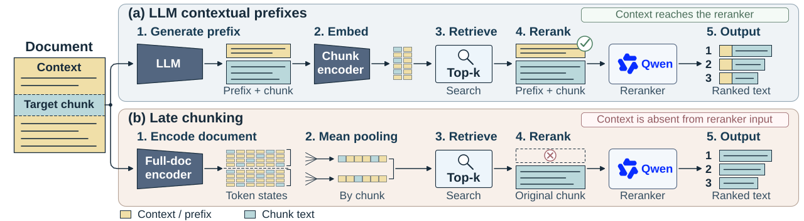

<p align="center">
  <strong><a href="https://sstan1.github.io/ConTra-Context-That-Travels/">Project Website ↗</a></strong>
</p>

<p align="center">
  
</p>

<p align="center">
  <strong>ConTra: A Training Framework for Effective Contextual Retrieval via Prefix Generation</strong>
</p>

<p align="center">
  Jiajun Hou · Jingbang Chen<br>
  CUHK-Shenzhen · SLAI
</p>

<p align="center">
  <a href="https://arxiv.org/abs/2611.34366">Paper</a> &nbsp;·&nbsp;
  <a href="https://huggingface.co/collections/JJHou1/contra-context-that-travels-6b0803475f61d1ce6059e938">Hugging Face</a> &nbsp;·&nbsp;
  <a href="#method">Method</a> &nbsp;·&nbsp;
  <a href="#realcontextbench">RealContextBench</a> &nbsp;·&nbsp;
  <a href="#results">Results</a>
</p>

| ConTEB | RealContextBench | Short-document indexing |
| :---: | :---: | :---: |
| **85.25** | **66.92** | **7.74× faster** |

ConTra-2B paper results. Retrieval scores are reranked nDCG@10 × 100; indexing speed is relative to prompted 9B on a single H100 80GB.

---

## Method

ConTra uses reinforcement learning (RL) to train Qwen3.5 models to write compact, source-supported context prefixes. At indexing time, the model reads a target chunk and its surrounding text, then prepends its prefix to the original chunk. The augmented text is used for both embedding retrieval and reranking, with each prefix reused across queries.

<p align="center">
  
</p>

## RealContextBench

RealContextBench combines application collections with controlled context conditions. Each application collection forms a shared retrieval corpus, with original questions and gold chunks mapped from human-annotated answers or supporting evidence.

| Collection | Domain | Queries | Documents | Chunks |
| :--- | :--- | ---: | ---: | ---: |
| Natural Questions | Web search | 5,499 | 5,181 | 99,096 |
| TechQA | Technical support | 149 | 139 | 1,036 |
| FairytaleQA | Story comprehension | 1,007 | 23 | 342 |
| QMSum | Meetings | 244 | 35 | 2,140 |
| FinanceBench | Financial analysis | 146 | 84 | 45,049 |

The three NanoBEIR conditions keep queries, target chunks, and relevance annotations fixed across 13 underlying tasks.

| Condition | Surrounding context |
| :--- | :--- |
| **Original** | The target chunk alone. |
| **Random** | Two randomly sampled passages before the target and two after it. |
| **Topical** | Four independent Luna-generated passages on the target's narrow topic, describing unrelated subjects, cases, or events. |

## Results

Reported macro-averaged **nDCG@10 after top-15 reranking** with Qwen3-Reranker-4B.

| Method | ConTEB | RealContextBench |
| :--- | ---: | ---: |
| Qwen3-Embedding-4B, original text | 0.6483 | 0.6373 |
| InSeNT | 0.6381 | 0.5291 |
| PPLX-context-0.6B | 0.7110 | 0.6083 |
| PPLX-context-4B | 0.7310 | 0.6542 |
| Voyage-context-3 | 0.7292 | 0.6636 |
| Voyage-context-4 | 0.7300 | 0.6608 |
| Qwen3.5-0.8B | 0.6531 | 0.6384 |
| Qwen3.5-2B | 0.7585 | 0.6456 |
| Qwen3.5-4B | 0.8110 | 0.6553 |
| Qwen3.5-9B | 0.8279 | 0.6632 |
| **ConTra-0.8B** | **0.7346** | **0.6471** |
| **ConTra-2B** | **0.8525** | **0.6692** |
| **ConTra-4B** | **0.8465** | **0.6669** |

ConTEB averages eight tasks. RealContextBench averages five application collections and three NanoBEIR conditions. Contextual encoders supply original chunks to the reranker; prefix-based pipelines supply the prefix and original chunk.

## Citation

```bibtex
@misc{hou2026contra,
  title         = {{ConTra}: A Training Framework for Effective Contextual Retrieval via Prefix Generation},
  author        = {Hou, Jiajun and Chen, Jingbang},
  year          = {2026},
  eprint        = {2611.34366},
  archivePrefix = {arXiv},
  primaryClass  = {cs.IR},
  url           = {https://arxiv.org/abs/2611.34366}
}
```
